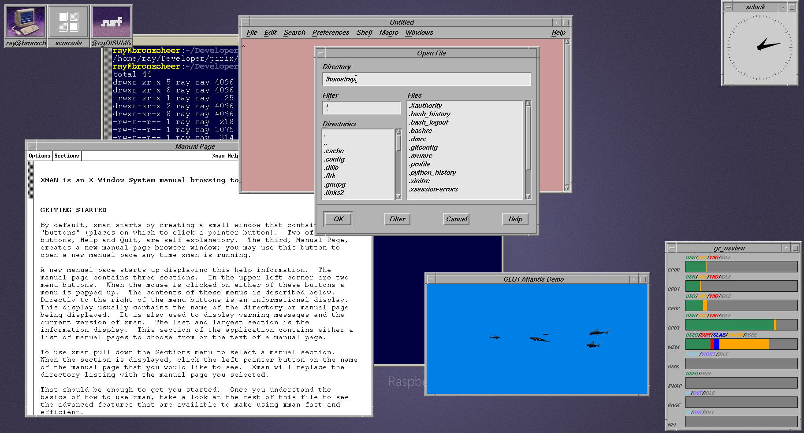
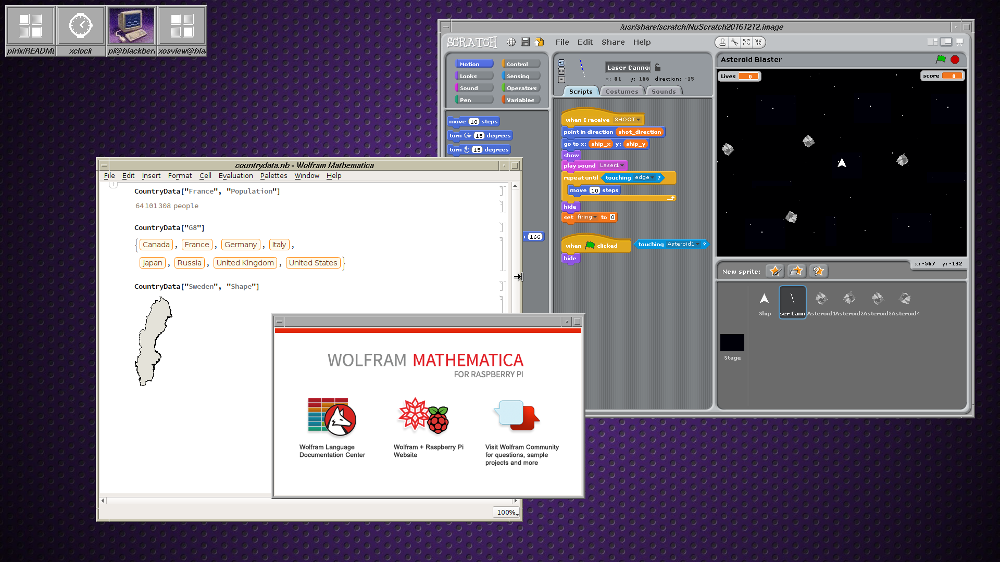
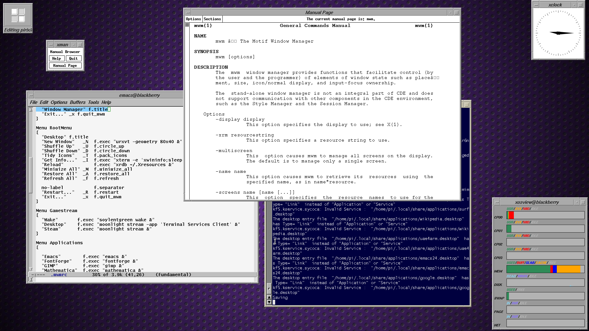

# piRIX

piRIX is an emulation of SGI's IRIX Interactive Desktop on Raspberry Pi 3/4
(and some other platforms).

Besides being nostalgic, this desktop environment is fast and easy on Pi 
resources.

## Installation

On Debian distributions, you'll need a few packages first.

	apt install \
	emwm motif-clients freeglut3-dev imagemagick \
    xosview xfonts-100dpi xfonts-75dpi x11-apps xloadimage

As usual, Fedora distributions will use different names for these packages.

We assume you have an X11 terminal emulator installer installed so
`x-terminal-emulator` resolves to something.

Then install:

    make install

Put this in your `$HOME/.xsession`, or possibly `$HOME/.xinitrc`:

    . $HOME/.config/pirix/pirixrc

If you're booting directly to PIXEL Desktop, change your boot setting
with `raspi-config` to drop into a shell. Then start your session with

    startx

or other method you use to start your desktop.

## What gets installed?

Files will be installed to

    $HOME/.config/pirix

Any changes you may have made to files already there will be overwritten.

## How do I uninstall this?

Undo anything you did to .xsession and .xinitrc, then

    rm -r $HOME/.config/pirix

## Where is the Toolchest?

There ain't none (but see #2).
Find a compromise by pressing your left mouse button
over the desktop root window.

## Goodies

If you want the demos,

    make install-demos

The Toolchest (well, the thing that must serve for it)
has menu items to launch them.

## Does this hackamadoodle only work on the Pi?

Actually it ought to work in many other Linux contexts, like clan Debian
or clan Fedora.  There have been minor problems with OpenBSD but we hear
it still works.  @rhaleblian even got it working in WSL2 and X410.

This hackamadoodle really just sets resources for `mwm` so that you get
that particular CDE-like feeling.
So if your whatever-NIX has `mwm` you're mostly there.

If you get it working in macOS, post about that.

## Notes

This tweak bases itself on `emwm`, a modernization of Motif Window Manager.

A lot of things aren't here, including
* styling modifications to Motif (those rounded windows and scrollbars)
* the toolchest (i think you could write an Xm app of buttons with menus
  and no frame)
* the file manager (remember that they drew scalable vector icons)
* a contemporary web browser (Netscape Navigator or NCSA Mosaic)

## TODO

* somebody write a toolchest replacement
* there's a starting point for a file manager at src/pirix/filemanager
* add icon images for more applications
* other omissions mentioned in the notes you may have just read

## Credits

* IRIX - Silicon Graphics Computer Systems
* Motif - The Open Group
* GL Demos - opengl.org
